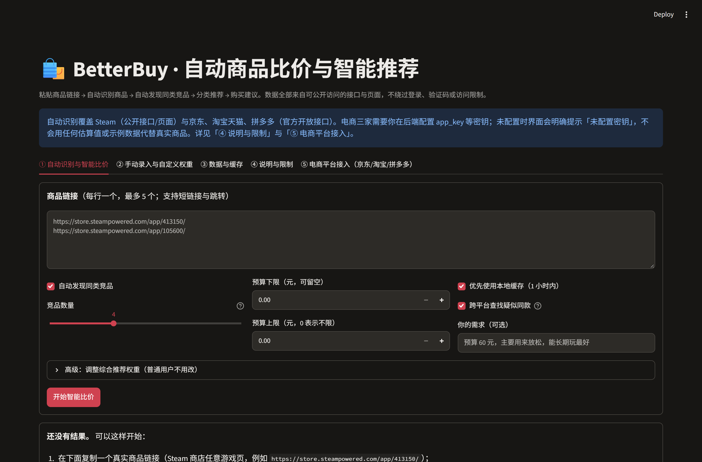

# BetterBuy 智选 · 面向大学生的 AI 理性消费与绿色消费助手

> **一句话**：先问「该不该买」，再问「买哪一个」。
> 用户粘贴商品链接、写个商品名，或者直接用一句话说清需求，系统给出
> 「推荐购买 / 建议进一步比较 / 建议暂缓购买」的结论、更省钱的替代路径，以及下单前必须确认的风险点。
> 拿不到的数据如实标"数据源未提供"，不编造、不猜价、不假装大模型。

本地 Streamlit 应用，Python + SQLite，零云服务、零付费 API、不上传任何数据。

> **正式站点**：https://betterbuy-ewtcn8eechfdqdrr2zymch.streamlit.app/
> （代码里的唯一来源是 `betterbuy/site.py` 的 `OFFICIAL_URL`；换地址必须同时改代码与文档，
> 否则 `SiteIdentityTests` 会失败。）

> **部署**：本仓库是 GitHub / Streamlit Community Cloud 的部署版。
> 上传与部署步骤、密钥配置方式、云端限制，见 [DEPLOY.md](DEPLOY.md)。
> **仓库可以公开**——密钥只存在云端 Secrets 里，不进代码；公开实例建议加一道
> 访问口令并把每日上限压到演示档（详见 DEPLOY.md「仓库要公开怎么办」）。



> **参赛**：本版本为「AI青年行·2026高校好事计划」参赛作品（征集期 2026-10-29 至 11-30，
> 主办：中国光华科技基金会，指导：共青团中央基层建设部，技术支持：WorkBuddy）。
> 参赛材料见 `docs/`。

> **零成本是硬约束**（2026-11-14 起最高优先级）：开发者支出必须为 0 元。
> 具体做法是代码强制的——大模型默认禁用、每个数据源有每日请求上限、超限即停、无密钥不采集。
> 详见 [§13 零成本约束](#13-零成本约束最高优先级)。

---

## 1. 这一版到底能做什么（先看边界，再看功能）

### 页面只有 3 个标签页（2026-11-15 第二轮精简）

普通用户打开网页只需要做一件事：**输入商品名 → 看真实商品 → 看建议**。所以前台只留三页：

| 标签页 | 作用 | 面向谁 |
|---|---|---|
| 购买建议 | 首页：产品名 + 一句话价值 + 需求输入框；商品名 / 需求 / 链接三种输入，写商品名会自动去官方接口搜真实商品 | 普通用户 |
| 商品对比 | 批量链接比价、竞品发现、权重调整；手动录入与「按关键词搜一批」收在本页折叠区 | 想深入比较的人 |
| 使用说明 | 30 秒用法、能力边界、数据口径、已知限制；运行状态与平台接入收在末尾「高级设置」 | 评审 / 想核实的人 |

首屏设计规则（有测试钉住，别改回去）：

1. **产品名 + 一句话价值 + 需求输入框**，三样东西优先，技术说明一律后置；
2. 参赛信息在页脚，数据声明压成一句，详细内容进折叠；
3. 预算默认**留空**（不是 0），避免「预算 0 元」的歧义；
4. 示例是**可点击按钮**，点一下自动填进输入框，不需要手动复制；
5. 结论下方一行说清「分析方式 / 数据来源 / 数据更新时间」，用户要知道结论依据。

原来的「数据与缓存」「电商平台接入」「零成本与配额」三个**配置型页面已从导航移除**，
但对应能力一个都没删：SQLite 缓存与价格历史、三家平台适配器、密钥读取、
每日请求上限与超限拦截仍然全部生效，只是改从环境变量 / Streamlit Secrets 配置，
用量与平台状态显示在「使用说明 → 高级设置」。普通用户因此不需要、也不会被要求配置任何 API。


### ✅ 公益版新增（这一版的主要工作）

| 能力 | 实现方式 | 真实性 |
|---|---|---|
| 三种输入都能分析（链接 / 商品名 / 一句话需求） | 链接走适配器采集；商品名走官方关键词搜索；纯需求走规则解析 | 已验证（3 个场景 + 搜索链路 8 个测试） |
| 三档购买结论：推荐购买 / 建议进一步比较 / 建议暂缓购买 | 判定表 + 阈值，规则全部可回溯 | 已验证，有 17 个测试 |
| 需求理解（品类、预算、用途、频率、已有设备） | 关键词 + 正则 + 分段规则，**非大模型** | 已验证，有 20 个测试 |
| 区分「要买的东西」和「已经有的东西」 | 按标点分段 + 购买动词窗口 + 段内头词 | 已验证（易错点） |
| 绿色消费建议（维修/升级/二手/不买） | 14 个品类的知识库，全部定性、不给碳数字 | 已验证，有 20 个测试 |
| 购买风险提示（7 类） | 只用真实字段判定，不确定标「待核实」 | 已验证 |
| 分析依据逐条公开 | `trace` 记录每条规则是否命中 | 界面可展开查看 |

### ✅ 原有能力（一行未删）

### ✅ 真实可用

| 能力 | 实现方式 | 真实性 |
|---|---|---|
| 粘贴 Steam 链接自动识别商品 | 官方公开接口 `api/appdetails` + 公开商品页 | 已用真实链接验证 |
| 短链接 / 跳转链接解析 | 跟随 302 重定向后取 appid（如 `s.team/a/413150`） | 已验证 |
| 自动发现同类竞品 | Steam 公开搜索页，按「类型 + 价格区间」检索 | 已验证 |
| 五类分类推荐 | 全部基于采集到的真实字段计算 | 已验证 |
| 价格/口碑对比图 | 真实价格与真实好评率 | 已验证 |
| 规则版购买建议 | 预算解析 + 真实数据推导 | 已验证 |
| 逐字段来源与采集时间 | 每个字段挂 `Source`（适配器/方式/地址/时间） | 已验证 |
| 价格历史 | SQLite 记录每次价格变化 | 已验证 |

### ⚠️ 有条件可用（需要你自己去申请资质）

- **京东 / 淘宝天猫 / 拼多多**：代码已按官方开放接口接入（独立适配器 + 签名 + 字段映射），
  但**必须配置你自己的 app_key 等密钥**才能取数。未配置时界面会明确报「未配置密钥」，
  不会退回抓页面、更不会用示例数据顶替。三家都是「推广/联盟」口径，只有进入推广池的商品查得到。
  详见 [§12 电商开放平台接入](#12-电商开放平台接入京东--淘宝天猫--拼多多)。
- **其他网站的商品链接**：只有当页面发布了标准商品结构化数据（schema.org / JSON-LD，
  或 `og:price:amount` 元标签）时才能识别。能读到什么就给什么，读不到就标缺失。

### ❌ 未实现（不做假装）

- **好评率百分比（电商三家）**：京东/淘宝/拼多多都不提供。淘宝只有布尔值 `h_good_rate`
  （且需 SA 级权限），拼多多无口碑字段。所以电商商品没有口碑分，推荐里标「数据不足」。
- **评价正文（全部平台）**：Steam 的 `appreviews` 接口在本机返回占位页；电商三家的推广接口
  根本不返回评论内容。
- **平台官方的跨平台同款标识**：不存在这种接口。本项目用「品牌 + 型号 + 标题相似度」算出
  **疑似同款**，界面上也是这么写的，不当成权威结论。
- **OCR / PDF / 图片识别**、**登录后页面**、**验证码绕过**：均不做。

---

## 2. 三步跑起来

### 2.1 安装（Windows 11）

```powershell
cd product_compare_project
py -m venv .venv
.venv\Scripts\activate
python -m pip install -r requirements.txt
```

已有 `.venv` 的话，直接跳到下一步。

### 2.2 启动

```powershell
.venv\Scripts\python.exe -m streamlit run app.py
```

或双击 `start_windows.bat`。浏览器打开终端提示的地址（默认 http://localhost:8501）。

### 2.3 验证一次真实分析（60 秒）

1. 打开「购买建议」（默认就是第一个标签页），写一句需求或贴一个链接；
2. 把下面任意一行粘进输入框：

```text
https://store.steampowered.com/app/413150/
https://store.steampowered.com/app/105600/
https://store.steampowered.com/app/322330/
```

3. 点「开始智能分析」（「顺带比同类商品」默认勾选，只对 Steam 生效）；
4. 依次查看 ①~⑥ 区块：商品信息 → 价格比较 → 购买建议 → 绿色建议 → 风险提示 → 数据来源，
   最后展开「查看分析依据」核对每条规则。

> 不想贴链接也可以，直接写一句话，例如
> `我的笔记本是联想拯救者 Y7000P，想买个外接显示器，预算 1000 元，每天写代码要用`。
> 没有商品数据时仍然会给出需求分析、绿色建议和风险清单——这是公益版刻意设计的降级路径。

原有的完整比价流程在「商品对比」标签页，用法与之前一致：

1. 粘贴上面三个链接；
2. 勾上「自动发现同类竞品」，点「开始智能比价」；
3. 依次查看 ①~⑧ 区块：识别状态 → 竞品列表 → 参数表 → 价格图 → 口碑 → 五类推荐 → 购买建议 → 来源与更新时间。

> 首次运行时每个链接会请求 2 次（官方接口 + 商品页），默认间隔 1.2 秒，
> 加上竞品深采大约 10~20 秒。1 小时内重复分析同一链接直接走缓存。

### 2.4 跑三个真实场景（不需要联网）

```powershell
.venv\Scripts\python.exe scripts\scenario_test.py
```

会真实跑完「数码配件 / 学习用品 / 修还是换」三个场景，把每一步的实际输出写到
`reports/scenario_<时间戳>.md`。这是参赛材料里「已实现成果及其证据」的来源。

### 2.5 批量验证 5 个真实链接（需要能访问 Steam）

```powershell
.venv\Scripts\python.exe scripts\verify_live.py
```

会输出每个链接的字段覆盖率，并在 `reports/` 下生成 JSON + Markdown 报告。
也可以自己指定链接：

```powershell
.venv\Scripts\python.exe scripts\verify_live.py "https://store.steampowered.com/app/1245620/" --no-cache
```

---

## 3. 代码结构

```text
app.py                          Streamlit 界面（3 个标签页：购买建议 / 商品对比 / 使用说明）
betterbuy/
  models.py                     统一数据模型：Product/Offer/Rating/Source（含字段级来源）
  netguard.py                   只允许公网 http(s)，拦截内网与本地地址
  http_client.py                统一请求层：限速、robots、重试、错误分类、短链解析
  cache.py                      SQLite：商品快照 / 价格历史 / 采集日志
  normalize.py                  名称清洗、价格与百分比解析、品牌型号抽取、同款判定
  linkdetect.py                 链接识别：平台判定 + 商品 ID 提取（京东/淘宝/天猫/拼多多/Steam）
  openapi/                      电商开放平台（三家独立客户端）
    credentials.py              只从环境变量读密钥，脱敏展示
    signing.py                  三家签名：排序拼接 + 首尾加 secret + MD5 大写
    transport.py                发请求、识别 error_response、剥外层包装
    fields.py                   容错取值（取不到就留空，不填默认值）
    jd.py                       jd.union.open.* 客户端
    taobao.py                   taobao.tbk.* 客户端
    pdd.py                      pdd.ddk.* 客户端
  adapters/
    base.py                     适配器协议
    steam.py                    Steam 适配器（官方接口 + 公开商品页）
    ecommerce_base.py           电商适配器公共部分（短链展开、密钥检查、错误翻译）
    jd.py / taobao.py / pdd.py  三个平台适配器 + 字段映射（映射函数可单独测）
    schema_org.py               schema.org / JSON-LD 解析（平台无关）
    generic_html.py             通用网页兜底（JSON-LD -> 元标签 -> 仅标题）
  discovery/
    steam_search.py             Steam 搜索页竞品发现
    ecommerce.py                跨平台「疑似同款」检索（品牌+型号+标题相似度）
  recommend.py                  五类推荐算法（可解释、有样本门槛）
  advisor.py                    购买建议（规则版 + 可选大模型）
scraper.py / scoring.py         V0.1 的手动流程（原样保留，界面里仍可用）
tests/                          319 个离线测试用例（2 个联网用例默认跳过）
  fixtures/                     从真实响应摘录的测试夹具
scripts/verify_live.py          Steam 真实链接验证
scripts/check_openapi.py        电商开放平台自检（密钥状态 + 可选真实调用）
backups/v0.1_20261114_1235/     改造前的完整可运行版本
data/betterbuy.sqlite3          本地数据库（首次运行自动创建）
```

**为什么这样拆**：每加一个平台只需写一个 `adapters/xxx.py` 并注册，不动其他文件；
竞品发现同理（`discovery/`）。旧的 `scraper.py` / `scoring.py` 一行未改，避免回归。
电商三家的协议差异全部收在 `openapi/` 里，`adapters/` 只做「调接口 + 映射字段」。

---

## 4. 数据从哪来，怎么保证不造假

### 4.1 Steam 适配器

| 字段 | 来源 | 说明 |
|---|---|---|
| 名称 / 品牌 / 类别 / 型号 | `api/appdetails` | 开发商作品牌，类型+Steam 数字版作型号 |
| 价格 / 货币 / 折扣 | `api/appdetails.price_overview` | 分转元，`cc=cn` 中国区标价 |
| 好评率 / 评价等级 / 近期评测 | 公开商品页 `.user_reviews_summary_row` | **语言维度口径**，界面标注"简体中文评测口径" |
| 评价总数（全语言） | `api/appdetails.recommendations` | 与中文评价数分开显示，便于核对 |
| 支持平台 / 语言 / 功能 / 发售日 / Metacritic / DLC / 最低配置 | `api/appdetails` | 原样映射，不加工 |
| 评价正文 | ❌ 不可得 | 接口返回占位页，标记缺失 |

### 4.2 四条硬规则

1. **缺失就是缺失**：`Product.missing` 会列出所有没拿到的字段，界面显示"数据源未提供"。
   价格缺失时**不会**填 0，货币缺失时**不会**默认人民币。
2. **星级 ≠ 好评率**：`4.8/5` 只换算成"评分参考"，绝不写成"96% 好评"。
3. **不猜价格**：只读结构化字段（JSON-LD / `product:price:amount` / 官方接口）。
   "限时 299 元"这种营销文案不会被当价格。测试里专门有一条 `test_marketing_price_is_not_used`。
4. **每个字段可追溯**：`Source(adapter, label, url, method, fetched_at)`，
   界面「⑧ 数据来源、更新时间与可信度」逐字段列出。

### 4.3 合规

- 请求遵守 `robots.txt`（Steam 只禁止少量路径，商品页与搜索页允许）；
- 全局限速 1.2 秒/请求，最多 5 个链接/次，竞品最多 8 个；
- 遇到 401/403/429 立即停止并如实报错，**不重试绕过**；
- 不绕过登录、验证码、付费墙；不批量抓取；
- 数据只写本机 SQLite，不上传服务器，无账号体系、无埋点。

---

## 5. 推荐算法（可复现、可解释）

| 类别 | 公式 | 门槛 |
|---|---|---|
| 性价比最优 | 平滑好评率 ×（组内最低价 ÷ 本品价） | 价格 + 好评率 |
| 口碑较好 | (好评率×评价数 + 70×50) ÷ (评价数+50) | 好评率 |
| 规格/内容最优 | 媒体评分 60% + 支持语言 20% + 功能特性 20% | 至少 2 项可算 |
| 预算友好 | 先筛口碑 ≥ 75，再取最低价 | 价格 + 好评率 |
| 综合最推荐 | 性价比 30% + 口碑 35% + 规格 25% + 价格 10% | 权重覆盖 ≥ 60% |

约束：

- **同一类别至少 2 个有效样本**，否则不产出冠军，直接说明原因（`Pick.empty_note`）；
- 多种货币**不做汇率换算**，只比较数量最多的那一组，并提示；
- 每个推荐都必须给出：依据（带具体数字）、优势（与其他候选比较）、缺点与风险（数据可证实的）、
  适合人群、数据缺口、置信度（高/中/低）；
- 缺点不是模板文案：低评价数、近期口碑下滑、无简体中文、仅 Windows、有付费 DLC、
  价格高于中位数、缺媒体评分等，都是按字段触发的。

**游戏类没有"硬件性能"**，所以"规格/内容最优"用媒体评分 + 内容体量近似，界面写明这一点，
不会把它说成性能跑分。

---

## 6. 测试

```powershell
.venv\Scripts\python.exe -m unittest discover -s tests -v
```

**结果：319 个用例，317 通过，2 个联网用例默认跳过（`BETTERBUY_LIVE=1` 时启用）。**

| 文件 | 用例 | 覆盖内容 |
|---|---|---|
| `test_core.py` | 8 | V0.1 遗留：JSON-LD 解析、评分公式 |
| `test_models.py` | 14 | 字段来源、缺失清单、完整度、旧表格兼容、序列化 |
| `test_normalize.py` | 21 | 全角/价格/百分比/万、品牌型号、同款判定、去重 |
| `test_steam_adapter.py` | 15 | 链接 7 种形态、字段映射、无币种不猜、评论缺失标注 |
| `test_generic_adapter.py` | 10 | JSON-LD 嵌套/多报价/评价正文、无结构化数据、营销价不采信 |
| `test_discovery.py` | 14 | 搜索页解析、折后价、排除自身、价格过滤、失败如实报告 |
| `test_recommend.py` | 19 | 公式、样本门槛、货币分组、评价最多≠口碑最好、权重影响 |
| `test_advisor.py` | 20 | 预算 5 种写法、超预算、建议只引用真实商品、LLM 未配置时回退 |
| `test_cache.py` | 11 | 同价不重复记史、币种变化、日志、清理、跨实例持久化 |
| `test_app_smoke.py` | 6 | 用 AppTest 走完整渲染路径（离线、注入真实数据形状） |
| `test_live.py` | 2 | 联网端到端（默认跳过） |
| `test_linkdetect.py` | 19 | 京东/淘宝/天猫/拼多多/Steam 链接识别、短链、缺 ID 不瞎猜 |
| `test_openapi_signing.py` | 18 | 三家签名：排序拼接、首尾加 secret、大写 MD5、空值不参与 |
| `test_openapi_clients.py` | 21 | 网关参数、外壳剥离、错误码分类（假 transport，不联网） |
| `test_ecommerce_adapters.py` | 30 | 字段映射、销量≠评价数、布尔≠好评率、无密钥降级、同款判定 |
| `test_zero_cost.py` | 26 | 零成本开关、配额超限即停、超限不发请求、缺数据跳转链接、付费端点扫描 |
| `test_intent.py` | 20 | 品类识别、购买目标 vs 已有设备、复合词头词、需求解析、缺失不猜 |
| `test_ration.py` | 17 | 三档结论边界、价格不判冲动、无数据不给推荐、trace 完整性 |
| `test_green_risk.py` | 20 | 绿色建议无量化环境数字、建议去重、七类风险、待核实语义 |
| `test_wise.py` | 13 | 编排层：无链接不请求、采集失败仍可用、品类覆盖、链接数上限 |

### 真实链接验证

5 个真实 Steam 链接（Stardew Valley / Terraria / 饥荒联机版 / 艾尔登法环 / Hades）全部跑通，
字段覆盖率 100%，缺失项只有「评价内容」，与开发结论一致。

- `reports/live_verify_20261114_130650.md`（`--no-cache`，纯实时）：**5 个中 2 个当场采集成功**，
  另外 3 个报 `ProxyError`——本机到 `store.steampowered.com` 在 12:52 之后间歇超时。
- `reports/live_verify_20261114_130659.md`（带缓存）：5 个全部成功，
  其中 3 个复用当天早些时候**已经真实采集过**的数据，不是编造的。

两次结果按同一份代码产出，差异只在网络。**网络恢复后请自己重跑一次纯实时验证**：

```powershell
.venv\Scripts\python.exe scripts\verify_live.py --no-cache
```

报告自动写入 `reports/live_verify_*.md`。

**网络排查**：如果 `--no-cache` 大量报 `network`，

1. 先用浏览器打开 `https://store.steampowered.com/app/413150/` 确认能访问；
2. 如果浏览器能开而脚本不能，多半是系统代理/科学上网工具只对浏览器生效——
   在同一个终端里设好代理环境变量再跑（`set HTTPS_PROXY=http://127.0.0.1:端口`）；
3. Steam 商店在某些网络下会间歇性超时，隔几分钟重跑通常就好。
   程序会如实报 `网络访问失败`，**不会**拿旧数据或估算值冒充实时价格。

### 开发中修掉的真实 bug（不是一次写对）

1. 搜索结果页打折商品取到了**被划掉的原价**（48 而不是 24）→ 改为优先取 `.discount_final_price`，并取最后一个数字。
2. 支持语言被截断到 8 项，导致 Terraria 被误判"不支持简体中文" → 保留完整语言列表，判断用全量。
3. `guess_model` 对 `A22`、`A87` 完全失效 —— `\b` 在中文字符旁不成立，且单字母型号被 `{2,6}` 挡掉 → 改用后行断言 + `{1,6}`。
4. 标题后缀清洗不彻底（`…节能版立即购买-小米商城` 只去掉一半）→ 改成多模式循环剥离。
5. `评价总数（全语言）` 写进 `product.specs` 后被 `product.specs = specs` 覆盖 → 移到正确位置。
6. 缓存命中时商品被标成"自动发现"（`origin="cache"` 覆盖了 `user`）→ 由界面显式标注来源类型。
7. 链接格式错误时抛出 `UnsupportedLink` 被当成"解析异常" → 统一翻译为可读的采集错误。
8. 瞬时代理错误导致整次分析失败 → HTTP 层加有限重试（2 次，不重试 4xx）。
9. 综合推荐里价格因素占比过高（50%），会让最便宜的自动夺冠 → 权重调整为 30/35/25/10。
10. 缺点列表可能为空，界面出现"有标题没内容"的卡片 → 补明确的"未发现可证实缺点"提示。

---

## 7. 已知限制（按重要度排序）

1. **只有一个平台适配器**，所以"全自动"目前只对 Steam 成立，也没有同款跨平台比价。
2. 国内电商商品页没有可解析的公开结构化数据，无法自动识别；这是数据源问题，不是解析能力问题。
3. 好评率是 Steam 的**语言维度**口径，与全语言总数可能不同（两个数都展示了）。
4. 价格是采集时刻的公开标价，不含运费/税费/券后价；折扣有截止时间。
5. 竞品发现用「类型 + 价格区间」，同类型里风格差异可能较大，需要人工看参数再判断。
6. 大模型建议未做真实评测（本机未配置接口），只保证"未配置时一定回退规则版"。
7. 未做移动端适配走查（Streamlit 自带响应式，但窄屏下宽表格会横向滚动）。
8. SQLite 没有并发写保护，只适合单人本地使用。

---

## 8. 可选：接大模型（不是必需）

```powershell
$env:BETTERBUY_LLM_BASE_URL="https://你的兼容OpenAI的地址/v1"
$env:BETTERBUY_LLM_API_KEY="sk-..."
$env:BETTERBUY_LLM_MODEL="模型名"
```

配置后界面上会出现「允许把商品数据发送给已配置的外部大模型」勾选框，**默认不勾**。
即使调用失败也会自动回退规则版；模型返回的商品名会与本地数据比对，对不上的条目直接丢弃。

其他环境变量：

| 变量 | 默认 | 作用 |
|---|---|---|
| `BETTERBUY_DB` | `data/betterbuy.sqlite3` | 数据库位置 |
| `BETTERBUY_CACHE_TTL` | `3600` | 缓存有效期（秒） |
| `BETTERBUY_MIN_INTERVAL` | `1.2` | 请求最小间隔（秒） |
| `BETTERBUY_TIMEOUT` | `20` | 单次请求超时（秒） |
| `BETTERBUY_UA` | `BetterBuy/0.2 ...` | User-Agent |

---

## 9. 版本路线

| 版本 | 内容 | 状态 |
|---|---|---|
| V0.2 自动商品识别 | 粘贴链接 → 自动识别 → 展示真实信息 + 来源 | ✅ 已完成（Steam） |
| V0.3 多商品对比 | 多链接、对比表、价格图、口碑分析 | ✅ 已完成 |
| V0.4 自动竞品发现 | 同类型 + 价格区间检索真实竞品 | ✅ 已完成（Steam 一个类目） |
| V0.5 智能购买顾问 | 需求理解、优缺点、风险、决策算法 | 🟡 规则版完成，大模型增强为可选 |

### 下一步要做的事（按性价比排序）

1. 接入第二个平台（需先确认有合法公开接口），才能真正做同款跨平台比价；
2. 竞品匹配从"类型"升级到"标签 + 参数相似度"，减少风格差异；
3. 价格历史做成趋势图与降价提醒（数据结构已支持）；
4. 补充移动端窄屏的表格折叠；
5. 用真实用户做一轮权重校准。

---

## 10. 改造前的备份

`backups/v0.1_20261114_1235/` 保留了改造前的全部文件（app.py / scraper.py / scoring.py / README / tests / bat）。
需要退回旧版本时，把这几个文件覆盖回来即可，数据库与新版代码互不影响。

---

## 11. 交付清单

### 已完成

- [x] 检查现有项目，识别可复用部分（`scraper.py` / `scoring.py` 原样保留，旧功能搬到「商品对比」）
- [x] 备份可运行旧版本到 `backups/v0.1_20261114_1235/`
- [x] 判定真实可用数据源：Steam（官方公开 API + 公开商品页 + 公开搜索页）
- [x] 适配器架构（`adapters/` 按平台拆分）+ 统一数据模型（字段级来源与时间）
- [x] 粘贴一个链接 → 自动识别 → 展示真实信息（含缺失状态）
- [x] 多链接对比表、价格图、口碑散点图
- [x] 自动竞品发现（Steam 搜索页，同类型 + 价格区间）
- [x] 五类推荐 + 依据/优势/缺点/适合人群/数据缺口/置信度
- [x] 规则版购买建议（预算解析、分档替代、确认清单、不推荐原因）
- [x] SQLite 缓存、价格历史、采集日志、界面显示采集时间
- [x] 京东 / 淘宝天猫 / 拼多多 三个开放平台适配器（**代码已就位，等你的密钥**）
- [x] 跨平台「疑似同款」检索（品牌 + 型号 + 标题相似度，非官方同款标识）
- [x] **零成本约束层**：默认关闭大模型、每日请求配额硬上限、超限即停（§13）
- [x] 数据不足时的平台跳转出口（不带推广参数的公开搜索页）
- [x] 319 个自动化测试（317 通过 / 2 个联网用例跳过）
- [x] 真实链接验证脚本 `scripts/verify_live.py`、接口自检脚本 `scripts/check_openapi.py`
- [x] 本 README

### 已验证通过

- [x] 5 个真实 Steam 链接跑通全链路（字段覆盖 100%）；其中 2 个为当场实时采集，
      另 3 个因本机网络间歇超时复用了当天已采集的真实数据，明细见 `reports/`。

### 尚未完成 / 需要你补的

- [ ] **再跑一次纯实时验证**：本机到 Steam 的网络仍不稳定，请在网络正常时执行
      `scripts/verify_live.py --no-cache`，确认 5/5 均为当场采集。
- [ ] **电商三家的真实调用**：需要你按 §12.4 申请资质、配置密钥，然后跑
      `scripts/check_openapi.py --live`
- [ ] 用户评测正文（三家推广接口都不提供）
- [ ] 云端持久化价格历史（免费部署方案做不到，需要付费存储，本版不引入）

---

## 12. 电商开放平台接入（京东 / 淘宝天猫 / 拼多多）

> 这一段与 Steam 那条链路完全独立：Steam 走公开接口/页面，
> 这三家走**各家官方开放接口**，需要你自己的密钥与资质。代码已就位，缺的只是凭据。

### 12.1 已核实的网关与协议

| 平台 | 网关 | 请求方式 | 返回体外壳 | 时间戳格式 |
|---|---|---|---|---|
| 京东 | `https://api.jd.com/routerjson` | POST 表单 | `jd_union_open_xxx_responce`（平台原文如此拼写） | `yyyy-MM-dd HH:mm:ss`，东八区，±10 分钟 |
| 淘宝/天猫 | `https://gw.api.taobao.com/router/rest` | POST 表单 | `tbk_xxx_response` | `yyyy-MM-dd HH:mm:ss`，东八区 |
| 拼多多 | `https://gw-api.pinduoduo.com/api/router` | **仅 POST** | `xxx_response` | 秒级 UNIX 时间戳 |

三个网关都实测可达（HTTP 200），用无效密钥调用时都返回了结构化错误体：

```
京东   {"error_response":{"code":"21","zh_desc":"Invalid app_key ..."}}
淘宝   {"error_response":{"code":29,"msg":"Invalid app Key","sub_code":"isv.appkey-not-exists"}}
拼多多 {"error_response":{"error_code":10016,"error_msg":"client下线或者clientId不正确"}}
```

这说明**请求路径、参数名、错误封装都已经对上**；再往下只差有效密钥。

### 12.2 签名规则（三家形式相同，细节不同）

统一骨架：参数名升序 → 拼成 `key1value1key2value2` → 首尾各加 secret → MD5 → **转大写**。

差异点（均已实现并被测试钉住）：

- 京东：业务参数整体放在 `360buy_param_json` 里参与签名，值必须是**发送时那一份 JSON 字符串**，
  重新序列化就会验签失败；
- 淘宝/天猫：额外支持 `sign_method=hmac-sha256`；
- 拼多多：布尔必须是小写 `true`/`false`，签名串必须与请求体逐字一致。

**诚实说明**：签名算法按官方文档实现并有回归测试，但**没有有效密钥无法端到端验证**。
拿到密钥后跑一次 §12.5 的脚本即可确认。

### 12.3 每个字段到底能不能拿到

| 字段 | 京东 | 淘宝/天猫 | 拼多多 | 说明 |
|---|---|---|---|---|
| 商品名称 | ✅ | ✅ | ✅ | 接口直接给 |
| 价格 | ✅ | ✅ | ✅ | 推广口径价格；拼多多单位为分，已换算成元 |
| 图片 | ✅ | ✅ | ✅ | 主图 URL |
| 品牌 | ⚠️ | ✅ | ❌ | 京东多为品牌编码；拼多多无该字段 |
| 类目 | ✅ | ✅ | ✅ | |
| 规格 | ⚠️ | ✅ | ⚠️ | 淘宝详细版有 SKU/属性 |
| **好评率 %** | ❌ | ❌ | ❌ | 淘宝只有布尔 `h_good_rate`（还需 SA 权限） |
| **评价数** | ⚠️ | ❌ | ❌ | 淘宝只给 30 天销量 `volume`，**不能当评价数** |
| **评价正文** | ❌ | ❌ | ❌ | 三家推广接口都不返回 |
| 购买链接 | ✅ | ✅ | ⚠️ | 多为推广链接 |

因此这三家的商品**没有口碑分**。推荐算法会因缺少口碑而降低置信度，
样本不足时按既有规则**不产出冠军**，而不是拿销量凑一个假好评率。

### 12.4 需要你申请的东西

| 平台 | 要做什么 | 在哪做 |
|---|---|---|
| 京东 | 注册京东联盟 + 实名认证，创建推广位 | https://union.jd.com/ |
| 京东 | 开放平台创建应用，拿 app_key / app_secret | https://jos.jd.com/ |
| 京东 | 为应用申请 4 个 `jd.union.open.*` 接口权限 | 开放平台 → 应用管理 → 接口权限 |
| 淘宝 | 注册淘宝联盟推广者，创建推广位拿 `adzone_id` | https://pub.alimama.com/ |
| 淘宝 | 开放平台创建应用，拿 app_key / app_secret | https://open.taobao.com/ |
| 淘宝 | 申请淘宝客 API（物料搜索 + 商品详情） | 控制台 → 应用 → 权限管理 |
| 淘宝 | 用商品链接直接查，还需「消费者比价场景 ID2」权限 | 同上，需提工单说明用途 |
| 拼多多 | 注册多多进宝推广者，创建推广位拿 PID | https://jinbao.pinduoduo.com/ |
| 拼多多 | 开放平台创建应用 + 备案，拿 client_id / secret | https://open.pinduoduo.com/ |
| 拼多多 | 申请 `pdd.ddk.goods.*` 接口权限 | 控制台 → 应用详情 |

### 12.5 密钥怎么配、怎么验

密钥**只从环境变量读**，不写进代码、不进网页、不进日志（界面只显示前 4 位）。

```
BETTERBUY_JD_APP_KEY / BETTERBUY_JD_APP_SECRET
BETTERBUY_TB_APP_KEY / BETTERBUY_TB_APP_SECRET / BETTERBUY_TB_ADZONE_ID
BETTERBUY_PDD_CLIENT_ID / BETTERBUY_PDD_CLIENT_SECRET / BETTERBUY_PDD_PID
```

在 Windows 上用 `setx 变量名 "值"` 永久设置（或临时用 `set`），**之后重开终端**才生效。

```bat
.venv\Scripts\python.exe scripts\check_openapi.py
.venv\Scripts\python.exe scripts\check_openapi.py --platform jd --live
```

`--live` 会真的调一次接口，打印：成功条数、返回体的字段路径（用于核对映射），
或失败的错误码 + 处理建议。**它不会把示例数据写进界面。**

这些配置项现在只存在于后端（环境变量 / Streamlit Secrets）与本文档，
不再单独占用一个前台页面——普通用户不需要、也不应该自己配 API。
字段矩阵与权限清单见 §12.4 与 §13.9。

### 12.6 本轮实测结论（不美化）

- **调用成功的**：三个网关的连通性与错误封装（用无效密钥测的，见 12.1）。
- **需要权限才能跑通的**：全部业务接口——没有密钥，一次业务调用都不会成功。
- **能拿到的真实字段**：见 12.3，价格/标题/图片/类目/链接是稳定的。
- **还不能实现**：好评率百分比、评价数（淘宝拼多多）、评价正文、平台官方同款标识。
- **需要你做的**：按 12.4 逐条申请，把 8 个环境变量配好，跑 12.5 的脚本。

### 12.7 与旧版说法的一个差别

旧版 README 写过"国内电商无法自动识别"。现在准确的说法是：
**页面抓取依然不可行**（价格异步加载 + 风控），**但官方接口可以**。
所以本项目走接口、不抓页面；没有密钥时宁可什么都不显示。

### 12.8 拼多多关键词搜索（2026-11-15 新增）

「商品对比」里多了一个折叠面板：**换个方式找商品：按关键词搜一批**。
它不是抓页面，而是调官方 `pdd.ddk.goods.search`：

| 能力 | 接口 | 说明 |
| --- | --- | --- |
| 关键词搜索 | `pdd.ddk.goods.search` | `page_size` 官方只收 **10–100**，代码会夹取；返回名称/价格/图片/店铺/已售/goods_sign |
| 商品详情 | `pdd.ddk.goods.detail` | 按 `goods_sign` 查（`goods_id` 已下线），勾选"读取前 3 条详情"才调，每次 1 次额度 |
| 官方推广链接 | `pdd.ddk.goods.promotion.url.generate` | 只有接口真的返回了 URL 才显示；失败就留空，**不拼接替代链接** |
| 商品推荐 | `pdd.ddk.goods.recommend.get` | 客户端已封装，界面暂未挂入口 |

搜索结果直接进入统一比较与推荐流程（同一套 `recommend()` 与规则版建议），
所以"③ 核心参数对比表""④ 价格对比""⑦ 综合购买建议"里看到的是同一批商品。

**价格口径写在明处**：拼多多返回的是**拼团价**（单位分，已换算成元），
券后价是"拼团价 − 券面额"的**估算**，没有考虑用券门槛、限购和运费；
表格里专门有一列"价格口径"，形如
`拼团价 · 券后约 ¥109.00（满 ¥99 可用） · 不含运费（接口未返回运费）`。

失败分类是分开的，不和稀泥：

| 分类 | 典型错误码 | 你该做什么 |
| --- | --- | --- |
| 未配置密钥 | — | 配 `CLIENT_ID` / `CLIENT_SECRET` / `PID` 三项 |
| 凭证或签名无效 | 10016 / 10019 / 20004 / 20032 | 核对 client_id、secret，别带空格 |
| 接口权限不足 | 20031 / 30000 / 20005 | 申请 `pdd.ddk.goods.*` 权限包；别开 IP 白名单 |
| 需要授权备案 | 50001 + 60001 | 去多多进宝对 pid（及 custom_parameters）做备案 |
| 限流或超限 | 52101 / 70031 | 等一会儿；本项目另有每日上限，超限不发请求 |
| 没有匹配商品 | 成功但 `goods_list` 为空 | 换关键词；确认商品在推广池里 |

命令行自检（**不打印任何密钥值**）：

```bash
python scripts/check_pdd.py                       # 离线：只查配置与参数，不发请求
python scripts/check_pdd.py --live --keyword 机械键盘
python scripts/check_pdd.py --live --detail --link
```

退出码：`0` 成功 / `2` 未配置 / `3` 凭证 / `4` 权限 / `5` 备案 / `6` 限流 / `7` 无结果 / `8` 网络。

> 没密钥时不发请求、不编造数据：面板直接显示"未配置密钥：缺少 XXX"，
> Steam 与其他功能不受影响。

---

## 13. 零成本约束（最高优先级）

> 一句话：**开发、测试、公开试用阶段，开发者实际支出必须是 0 元。**
> 这条约束是代码强制的，不是靠自觉——见 `betterbuy/zero_cost.py`。

### 13.1 三条硬机制

| 机制 | 实现位置 | 行为 |
|---|---|---|
| 大模型默认禁用 | `advisor.llm_available()` | 零成本模式下恒返回 `False`，即使配了 `BETTERBUY_LLM_*` 也不会调用 |
| 每日请求配额 | `transport.post()` / `adapters.collect()` | 超限抛 `quota` 类错误，**请求根本不会发出** |
| 无密钥不采集 | `openapi/jd.py` 等 | 没有密钥直接抛 `no_credential`，不退回抓页面、不返回示例数据 |

有测试钉住（`tests/test_zero_cost.py`，26 个用例），其中包括
「配额耗尽时被 mock 的 HTTP 客户端一次都没有被调用」这种断言。

### 13.2 现在就能零成本跑的功能

| 功能 | 依赖 | 花钱吗 |
|---|---|---|
| 粘贴 Steam 链接 → 自动识别（名称/价格/好评率/评价数/图片/规格） | Steam 公开 API + 商品页 | 0 元 |
| 自动发现同类竞品 | Steam 公开搜索页 | 0 元 |
| 对比表 / 价格图 / 口碑散点图 | 本地计算 | 0 元 |
| 五类推荐 + 规则版购买建议 | 纯 Python | 0 元 |
| 缓存、价格历史、采集时间展示 | 本地 SQLite | 0 元 |
| 京东/淘宝/拼多多链接识别与商品 ID 提取 | 纯本地正则 | 0 元 |
| 电商商品采集（配好密钥后） | 官方免费推广接口 | 0 元（有额度） |

### 13.3 免费额度与调用限制（诚实版）

**必须区分两件事**：平台给的额度，和本项目自己设的上限。

本项目自设的保守上限（`BETTERBUY_DAILY_LIMIT_*` 可调）：

| 数据源 | 每日上限 | 为什么这么设 |
|---|---|---|
| 京东 | 200 次 | 远低于联盟常见配额，避免超限 |
| 淘宝/天猫 | 200 次 | 淘宝客接口有 QPS 与日调用限制，取保守值 |
| 拼多多 | 200 次 | 同上 |
| Steam | 600 次 | 无官方配额，但设上限避免被风控 |
| 通用网页兜底 | 300 次 | 同上 |
| **合计** | **800 次** | 跨源总闸，`BETTERBUY_DAILY_LIMIT_TOTAL` |

**平台真实额度**：京东联盟、淘宝客、多多进宝的接口本身不单独收费（属推广工具），
按账号等级/应用审核结果给每日调用量，具体数字在各自控制台可见，且会调整。
**我不在这里写死具体数字，因为我没法替你确认你账号的额度。** 以你控制台显示为准；
如果平台给的额度比上表高，你可以把环境变量调大。

计数口径：每采集一个商品链接记 1 次；电商开放接口按实际 HTTP 请求记 1 次。
计数落在本地 SQLite 的 `api_quota` 表，进程重启不清零，跨天自动从 0 开始。

### 13.4 需要申请的资格（免费，但要审核）

这些资质本身**不收费**，需要你实名与提交应用：

| 平台 | 要办的 | 入口 |
|---|---|---|
| 京东 | 京东联盟账号 + 实名 + 推广位；开放平台应用 + 接口权限 | union.jd.com / jos.jd.com |
| 淘宝/天猫 | 淘宝客推广者 + 推广位 `adzone_id`；开放平台应用 + 淘宝客 API 权限 | pub.alimama.com / open.taobao.com |
| 拼多多 | 多多进宝推广位 `PID`；开放平台应用 + 备案 + `pdd.ddk.goods.*` 权限 | jinbao.pinduoduo.com / open.pinduoduo.com |

详细清单见 §12.4。

### 13.5 不能免费实现的功能（说清楚，不绕）

| 做不到的事 | 原因 | 有没有免费替代 |
|---|---|---|
| 京东/淘宝/拼多多的好评率百分比 | 推广接口不返回；淘宝只有布尔值 `h_good_rate`，还要 SA 级权限 | 没有。本项目直接留空并降低置信度 |
| 评价正文 | 三家都不返回 | 没有 |
| Steam 评测正文 | `appreviews` 接口返回占位页 | 没有 |
| 官方「同款」标识 | 平台不存在这种接口 | 用标题相似度做「疑似同款」，并明确标注 |
| 云端持久化价格历史 | 免费档文件系统非持久 | 本机运行可持久化；云端要持久化就得付费存储 |
| 大模型润色建议 | 会产生费用 | 规则算法已能给出结构化建议（默认路径） |
| 全站商品覆盖 | 推广接口只覆盖推广池商品 | 没有 |

### 13.6 免费部署和长期运行

| 方案 | 费用 | 适用 | 注意 |
|---|---|---|---|
| **Streamlit Community Cloud** | 0 元 | 公开试用首选 | 公开仓库 + 免费档；**文件系统非持久**，休眠/重部署后缓存丢失；闲置会休眠 |
| 本机 / 局域网 | 0 元 | 开发、自己验证 | 数据最稳，`data/` 持久 |
| Hugging Face Spaces（Streamlit SDK） | 0 元 | 备用公开演示 | 免费 CPU 档，同样非持久 |
| Cloudflare Tunnel / ngrok 免费档 | 0 元 | 临时给他人看 | 本机需常开，地址会变 |

部署步骤（Cloud）：

1. 推到 GitHub **公开**仓库（`data/`、`reports/`、`backups/` 已在 `.gitignore`，不会上传）；
2. 打开 share.streamlit.io → New app → 选仓库 → Main file path 填 `app.py` → Deploy；
3. 密钥写在 App settings → Secrets（TOML 格式），**只存在服务端**，不会进仓库、不会到浏览器；
4. 免费档不需要绑卡，也没有「试用到期自动转付费」的机制。

**长期运行的现实**：免费档会休眠，首次访问要等唤醒；缓存会丢，意味着每次唤醒后
重新采集（会消耗当日配额）。如果要 7×24 稳定 + 持久历史，那就得付费——
本版按你的要求**不引入**，宁可承认限制。

### 13.7 把数据公开给其他用户看，合规吗

各平台的口径（依据公开协议整理的要点，**不构成法律意见**，上线前请核对协议原文）：

- **Steam**：公开商品页的价格/标题/图片可展示并注明来源；不要整页转载评测正文。
- **京东联盟**：允许在推广场景展示商品信息；不得改价或加价，须带推广链接。
- **淘宝客**：必须使用带 `pid` 的推广链接展示，不得去除推广标识、不得制造虚假优惠。
- **多多进宝**：同样限于推广场景，须用带 PID 的推广链接，不得篡改价格与销量。
- **通用**：推荐结论要标明「基于公开数据的比较结果」，同时展示数据来源与采集时间。

这张表已写进本文档（见上），界面不再单列；页面顶部横幅会显示当日请求用量与上限。

### 13.8 怎么验证一分钱没花

一条命令：

```powershell
.venv\Scripts\python.exe scripts\check_zero_cost.py
```

它会检查四件事并给出 PASS/CHECK 结论：

1. 零成本模式是否开启；
2. 大模型路径是否被拦住（即使你配了 `BETTERBUY_LLM_*`）；
3. 今日各数据源配额余量；
4. 代码里有没有写死已知付费服务的域名（会跳过脚本自身）。

输出示例（本机实测）：

```text
[1] 零成本模式：开启
    大模型路径：已禁用
[2] 今日请求：0/800 次，剩余 800 次
[3] 付费服务端点扫描
    未发现任何写死的付费服务端点

结论：当前配置不会产生任何费用。
```

加 `--json` 可给脚本消费。另外可以直接看 `data/betterbuy.sqlite3` 的 `api_quota` 表——
每一笔外部请求都在里面计数。

### 13.9 公网实例：别人点搜索花的是谁的额度

零成本层挡的是"花钱"，挡不住"被别人先花完"。应用一旦公开，任何人都能点按钮：

| 场景 | 会发生什么 | 怎么处理 |
| --- | --- | --- |
| 仓库公开、应用公开、密钥已配 | 陌生访客的每次搜索都消耗你的 client_id 额度 | 设 `BETTERBUY_ACCESS_CODE` 加口令；或设 `BETTERBUY_PUBLIC_DEMO=1` 把上限压到电商各 20 次/天 |
| 仓库公开、应用公开、密钥未配 | 电商按钮直接显示"未配置密钥"，Steam 比价与理性消费分析照常可用 | 什么都不用做，这是最省心的公网形态 |
| 仓库公开、应用链接不公开分享 | 你一个人用，额度不会被别人动 | 适合自己验证接口 |

口令与演示模式都是**可选开关**，不设时行为与之前完全一致（本地开发、自动化测试都不受影响）。
实现分别在 `betterbuy/access.py` 与 `betterbuy/zero_cost.py`（`public_demo()`）。
上传前跑 `python scripts/scan_secrets.py --tracked --history` 做一次自检，
它扫明文密钥、被跟踪的 `.env` / `*.sqlite3`、本机绝对路径。

---

## 14. 公益版：理性消费分析与绿色消费建议

> 这一节对应「AI青年行·2026高校好事计划」的改造。核心是一句话：
> **先问「该不该买」，再问「买哪一个」。**
> 原有比价能力一行没删，全部保留在「商品对比」。

### 14.1 三个新模块

| 模块 | 文件 | 做什么 | 输入 → 输出 |
|---|---|---|---|
| 需求理解 | `betterbuy/intent.py` | 从一句话里抽出品类、预算、用途、使用频率、已有设备、现有物品的问题 | 一句话 → `Intent` |
| 理性消费判定 | `betterbuy/ration.py` | 给出三档结论 + 依据 + 重点参数 + 确认清单 | `Intent` + 数据有无 → `RationResult` |
| 绿色消费建议 | `betterbuy/green.py` | 按「要不要买 → 修 → 升级 → 二手 → 买新」的阶梯给建议 | 品类 → `GreenAdvice` |
| 购买风险提示 | `betterbuy/risk.py` | 七类风险逐条核对，不确定的标「待核实」 | 商品列表 → `RiskReport` |
| 品类知识库 | `betterbuy/catalog.py` | 14 个品类的关键参数、兼容性规则、绿色路径 | 品类 key → `Category` |
| 编排层 | `betterbuy/wise.py` | 把上面全部串起来，可在不联网的情况下测试 | 用户输入 → `WiseResult` |

**为什么单独拆一个编排层**：界面只负责展示，判断逻辑全在 `betterbuy/` 里，
所以可以注入假的采集函数做离线测试（`tests/test_wise.py` 13 个用例全部不联网）。
如果把这些判断写进 `app.py`，就永远测不到「采集失败时会怎样」。

### 14.2 三档结论的判定表（可直接核对代码）

| 结论 | 触发条件（满足任一） | 含义 |
|---|---|---|
| **建议暂缓购买** | ① 没说用途 + 没给预算 + 没描述现有问题 + 没商品数据<br>② 已有同品类物品 + 没说明用途 + 没问题描述<br>③ 已有同品类物品 + 自认低频 + 没问题描述<br>④ 风险信号累计 ≥ 5 分<br>⑤ 促销话术 + 情绪化表述同时出现 | 现在下判断不可靠，先补齐信息 |
| **建议进一步比较** | ① 没有可比价格 / 字段不足<br>② 预算明显偏离该品类常见区间<br>③ 有数据但没说预算或用途<br>④ 风险信号 3–4 分<br>⑤ 描述了现有问题，但可能有低成本解法 | 需求可能成立，但缺数据或确认项 |
| **推荐购买** | 用途明确 + 预算落在合理区间 + 风险信号 < 3 + **有真实商品数据** | 需求、预算、数据三者一致 |

三条不能退让的规则，都有测试钉住：

1. **价格高低不参与冲动判定。** 预算偏高只会写「预算偏高」，不会写「你冲动了」。
   `trace` 里固定有一条 `价格是否被用于判定冲动消费 = 否`。
2. **没有商品数据就不给「推荐购买」。** 最多到「进一步比较」，并说明缺什么。
3. **每条结论可回溯。** `RationResult.trace` 记录每条规则是否命中及原因，
   界面上的「查看分析依据」直接展示这张表。

### 14.3 一个真实踩过的坑：购买目标 ≠ 已有设备

中文需求里极常见的一种句式：

> 我的**笔记本**是联想拯救者 Y7000P，想买个外接**显示器**，预算 1000 元

只做关键词匹配会识别成「买笔记本」。而这里前半句是**兼容性依据**，后半句才是购买目标。

现在的做法（`catalog.find_purchase_target`）：

1. 按标点切成短句；
2. 找「含购买动词（买/购买/入手/换个…）的短句」，取该短句内**最靠右**的品类词
   （中文修饰语在前、中心词在后，「打游戏用的显示器」头词是显示器）；
3. 带「我的 / 手上 / 室友」等前缀的品类词标记为**已有物品**，只用于兼容性核对，不当购买目标；
4. 只有已有物品时，若出现「换个新的」，按**替换**处理，目标是同类商品。

对应的测试在 `tests/test_intent.py::PurchaseTargetTests`（6 个用例）。

### 14.4 品类知识库覆盖 14 类

笔记本 / 显示器 / 键盘 / 鼠标 / 耳机 / 移动硬盘 / 充电宝 / 手机 / 平板 /
人体工学椅 / 台灯 / 学习用品 / 书籍 / 游戏，加一个「其他」兜底。

每类包含：关键参数（含常见坑）、兼容性规则、绿色路径、必要性提示。
没有收录的品类会明确说「该品类暂未收录专门规则」——不假装有规则。

**价格区间是经验参考，不是报价。** 界面上有一行固定说明：
「下列价格为该品类的常见价位经验区间……**不是任何具体商品的报价，也不来自实时接口**」。

### 14.5 绿色建议的边界

阶梯顺序固定，这个顺序本身最省钱也最减废：

`能不能不买 → 能不能修 → 能不能升级/换配件 → 能不能买二手/官翻 → 最后才是买新的`

三条自我约束（`betterbuy/green.py` 顶部写死，且有测试扫描源码）：

1. **不给任何量化环境数字。** 不写「减少 X kg 碳排放」「省下 Y 元」。
   本项目没有可靠的生命周期数据来源，写了就是编的。测试会扫描
   `catalog.py` / `green.py` 源码，出现 `\d+kg CO2`、`省下 \d+` 这类模式直接失败。
2. **不劝退必要购买。** 命中的品类会给一句必要性提示，例如文具类：
   「课程要求的指定教材、指定规格文具属于必需品」。
3. **不建议违规做法。** 不会提共享账号、破解、非官方渠道。

同族通用建议与品类专属建议会去重（`_FAMILY_SKIP`），避免「换电池」重复出现两次。

### 14.6 七类风险与「待核实」的语义

| # | 风险 | 判定依据 | 可能等级 |
|---|---|---|---|
| 1 | 型号不一致 | 标题相似度 ≥ 60% 但型号写法不同 | 高 |
| 2 | 配置/规格不同 | 同一规格字段在不同商品上取值不同 | 中 |
| 3 | 与设备不兼容 | 品类的兼容性规则 → **只给待确认清单** | 待核实 |
| 4 | 缺乏有效评价 | 无好评率且无评价数；或评价数 < 50 | 待核实 |
| 5 | 价格已过期 | 采集时间 > 48 小时（> 6 小时给「可能已变动」） | 高 / 中 |
| 6 | 来源不明确 | 缺少 `Source` 记录或价格字段没有来源 | 中 |
| 7 | 售后待核实 | 平台条款未收录 | 待核实 |

**「待核实」不等于商品有问题。** 它表示本项目拿不到判断所需的信息。
界面上原话是：「本项目没有质检数据与返修率，任何『质量差』的结论都是编的，所以不写。」

即使一条商品数据都没有，兼容性与售后这两类仍然会输出——因为它们只取决于品类，不取决于这件商品。

### 14.7 三个真实场景测试

```powershell
.venv\Scripts\python.exe scripts\scenario_test.py
```

| 场景 | 输入 | 实际结论 | 关键验证点 |
|---|---|---|---|
| 数码配件 | 笔记本 Y7000P + 想买外接显示器 + 预算 1000 | 建议进一步比较（高） | 识别成「显示器」而非「笔记本」；给出 3 条接口确认项 |
| 学习用品 | 笔记本和记号笔，预算 60，每天上课记笔记 | 建议进一步比较（高） | 「笔记本本子」不被当成笔记本电脑；预算判定合理 |
| 修还是换 | 手机电池一天充三次，预算 3000 | 建议进一步比较（中） | 第一条绿色建议就是「先换电池再考虑换机」 |

报告写在 `reports/scenario_*.md`，内容是程序当时的实际输出，不是事后整理的。

**不统计「成功率」**——三个场景是人工设计的路径，不是用户抽样，算百分比只会显得比实际更有说服力。

### 14.8 公益版新增的已知限制

1. **只收录 14 个品类。** 其他品类走兜底逻辑，不会硬套不存在的规则。
2. **规则解析不懂语义。** 「我不想要太吵的」会被识别成提到噪音，但不一定能推断出「安静是硬需求」。
   所以解析结果一律展示给用户确认，而不是直接当事实用。
3. **兼容性只能提醒，不能判定。** 拿不到用户设备型号，只能给「需要确认什么」。
4. **没有用户研究。** 判定阈值（风险 5 分暂缓、3 分比较）是基于常识设定的，
   没有用真实用户行为校准过。这一点在参赛材料里也照实写。
5. **绿色建议是定性经验，不是生命周期评估。** 没有 LCA 数据，所以不给数字。
